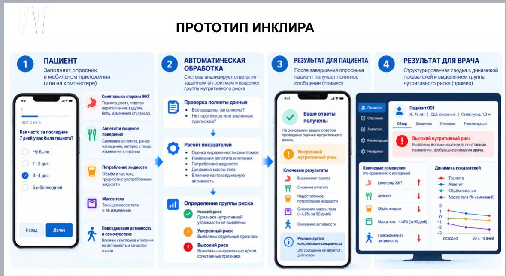

# medical_questionnaire
Программа для медицинского опроса пациентов

Описание программы:

- Врач создаёт карточку пациента;
- Пациент заполняет исходную анкету ДО начала терапии;
- Система обрабатывает и хранит в дальнейшем ответы;
- Формируется структурированный отчёт о результатах опроса пациента;
- Врач видит исходные показатели и результаты оценки;
- При повторном обращении (напоминание о необходимости пройти опрос через 3 месяца) пациент проходит контрольный опрос онлайн
- Врач видит график динамики, если состояние говорит о рисках - должно у врача всплыть окно что надо вызвать пациента на прием. Такое же окно и у пациента, что нужно на прием срочно;
- Добровольное внесение веса, сопутствующих препаратов и регистрация изменений самочувствия могут быть дополнительными функциями.

